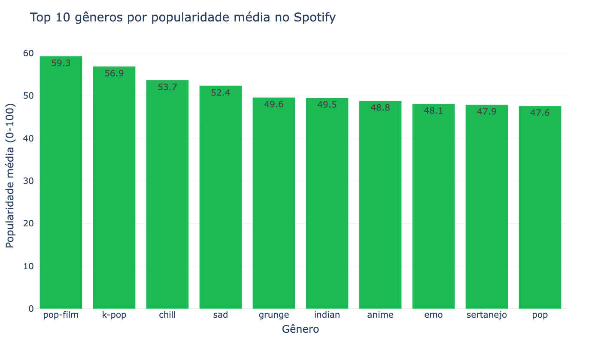
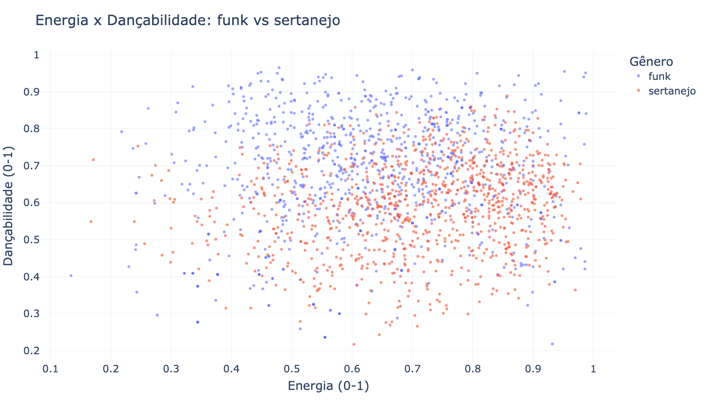

# Análise do Spotify com Python

Programa de terminal em Python que explora o dataset *Spotify Tracks* usando listas, dicionários e conjuntos, e gera gráficos com Plotly.


## Sobre o trabalho

| | |
|---|---|
| Disciplina | Algoritmos e Estruturas de Dados I |
| Curso | Tecnologia em Análise e Desenvolvimento de Sistemas (ADS) |
| Instituição | SENAC |
| Professor | Edécio Fernando Iepsen |
| Semestre | 3º semestre, 2026 |
| Atividade | Trabalho #2 (individual), apresentação em 19/10/2026 |

## Objetivo e requisitos

Praticar a manipulação de estruturas de dados (listas, dicionários e conjuntos) sobre um conjunto de dados real do Kaggle. Em resumo, o trabalho pede:

- carregar o dataset e organizá-lo em estruturas de dados da linguagem;
- oferecer um menu de terminal com diferentes consultas sobre os dados;
- usar conjuntos para comparar grupos;
- gerar gráficos a partir dos dados;
- apresentar o programa em sala.

## O dataset

[Spotify Tracks Dataset](https://www.kaggle.com/datasets/maharshipandya/-spotify-tracks-dataset), de maharshipandya, no Kaggle.

- 114.000 faixas
- 114 gêneros, com 1.000 faixas cada
- 21 colunas (incluindo uma coluna de índice sem nome)
- 89.741 `track_id` únicos nas 114.000 linhas (a mesma faixa aparece em mais de um gênero)

**Escopo:** catálogo global, sem coluna de país nem de ano. Os dados foram coletados pela Spotify Web API; o espelho no Hugging Face foi publicado em 06/2023 e os hits do topo são do fim de 2022, por isso "coleta 2022-2023". A `popularity` (0 a 100) é calculada pelo Spotify com base no total de reproduções e em quão recentes elas são.

Colunas usadas no programa:

| Coluna | Descrição |
|---|---|
| `track_id` | Identificador da faixa (usado para eliminar duplicadas) |
| `artists` | Artista(s) da faixa |
| `track_name` | Nome da música |
| `track_genre` | Gênero |
| `popularity` | Popularidade (0 a 100) |
| `explicit` | Se a faixa tem conteúdo explícito |
| `energy` | Energia |
| `danceability` | Dançabilidade |
| `valence` | Positividade musical |
| `tempo` | Andamento (BPM) |

> O arquivo CSV **não** está neste repositório (é grande e pertence a terceiros). Veja "Como rodar". Para a licença do dataset, a licença do dataset não foi confirmada: consulte a página dele no Kaggle.

## Funcionalidades

| # | Recurso | Estrutura de dados principal |
|---|---|---|
| 1 | **Agrupar:** popularidade média por gênero (top 15, com barras `█`) | dicionários de soma e quantidade (`.get`) + lista de tuplas ordenada com `sorted` e `lambda` |
| 2 | **Top N:** músicas mais populares, sem duplicadas | lista ordenada com `sorted` + `set` de `track_id` já vistos |
| 3 | **Comparar:** 2 ou mais gêneros (média de popularidade, energia, dançabilidade, alegria, BPM e contagem de explícitas) | lista de gêneros validados + listas filtradas por gênero |
| 4 | **Conjuntos:** artistas em comum (interseção), exclusivos (diferença) e total (união) entre dois gêneros | `set` |
| 5 | **Gráfico de barras (Plotly):** top 10 gêneros por popularidade média | lista de tuplas (reaproveita `calcular_media_popularidade()`) + Plotly |
| 6 | **Gráfico de dispersão (Plotly):** energia × dançabilidade de dois gêneros | listas paralelas + Plotly |

## Conceitos aplicados

- **Listas:** armazenar as músicas e os resultados ordenados.
- **Dicionários:** cada linha do CSV vira um dicionário; agrupamentos por gênero.
- **Conjuntos (`set`):** interseção, diferença e união de artistas; eliminação de duplicadas.
- **`sorted` com `lambda`:** ordenar por popularidade e por média.
- **`csv.DictReader`:** leitura do CSV como dicionários.
- **Plotly:** gráficos de barras e de dispersão.
- **Dicionário de funções:** o menu chama a função da opção escolhida com `opcoes[opcao]()`.
- **Funções reaproveitadas:** `calcular_media_popularidade()` serve à opção 1 e ao gráfico 5; `ler_genero()` valida a entrada com um `set`.

## Estrutura do projeto

```
analise-spotify-python/
├── .vscode/
│   └── settings.json     # aponta o interpretador para o .venv
├── .gitignore
├── LICENSE
├── README.md
├── docs/                 # imagens dos gráficos (README e slides)
├── requirements.txt
├── spotify.py            # programa principal
└── spotify-tracks.csv    # NÃO versionado: baixar do Kaggle
```

## Resultados

Resultados reais, testados com o dataset completo.

**Opção 1, popularidade média por gênero:** top 3 = pop-film (59,3), k-pop (56,9) e chill (53,7). O sertanejo fica em 9º (47,9) e o brazil em 15º (44,7).

**Opção 2, top 10 sem duplicadas:** 1º *Unholy* (Sam Smith;Kim Petras) com 100, 2º *Quevedo: Bzrp Music Sessions* com 99, 3º *I'm Good (Blue)* com 98 e 4º *La Bachata* com 98. Sem o `set`, o top 10 trazia só 4 músicas diferentes (*La Bachata* aparecia 4 vezes).

**Opção 3, comparar gêneros:**

| Gênero | Pop. | Energia | Dança | Alegria | BPM | Explícitas |
|---|---:|---:|---:|---:|---:|---:|
| sertanejo | 47,9 | 0,71 | 0,59 | 0,62 | 127,1 | 6 |
| funk | 32,3 | 0,63 | 0,68 | 0,60 | 117,8 | 304 |
| mpb | 40,8 | 0,58 | 0,57 | 0,56 | 120,2 | 5 |

**Opção 4, artistas em comum (sertanejo × pagode):** 246 artistas no sertanejo, 243 no pagode, união de 433 e interseção de 56 (ex.: Alexandre Pires, Exaltasamba, Dilsinho, Ferrugem). Só no sertanejo: 190; só no pagode: 187.

**Gráficos:**





No gráfico de dispersão, o funk fica mais alto em dançabilidade e o sertanejo mais à direita em energia.

## Como rodar

```bash
# 1. clonar o repositório
git clone https://github.com/joaowatanabe/analise-spotify-python.git
cd analise-spotify-python

# 2. baixar o CSV no Kaggle e salvar como spotify-tracks.csv na raiz do projeto
#    https://www.kaggle.com/datasets/maharshipandya/-spotify-tracks-dataset

# 3. criar e ativar o ambiente virtual
python3 -m venv .venv
source .venv/bin/activate

# 4. instalar as dependências
pip install -r requirements.txt

# 5. executar
python spotify.py
```

## Status

Concluído (apresentação em 19/10/2026).

- [x] 1. Agrupar: popularidade média por gênero
- [x] 2. Top N músicas
- [x] 3. Comparar gêneros
- [x] 4. Conjuntos de artistas
- [x] 5. Gráfico de barras
- [x] 6. Gráfico de dispersão

## Autor

João Vicente Watanabe, GitHub [@joaowatanabe](https://github.com/joaowatanabe).

## Licença

O **código** deste repositório é distribuído sob a licença [MIT](LICENSE). A licença cobre apenas o código: o dataset pertence ao autor original e segue a licença indicada na [página do Kaggle](https://www.kaggle.com/datasets/maharshipandya/-spotify-tracks-dataset).
